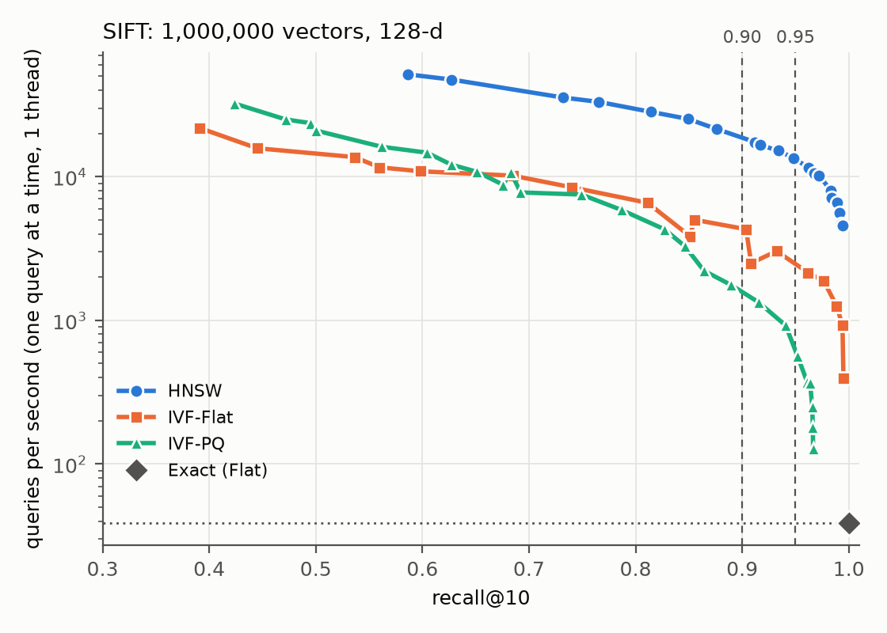
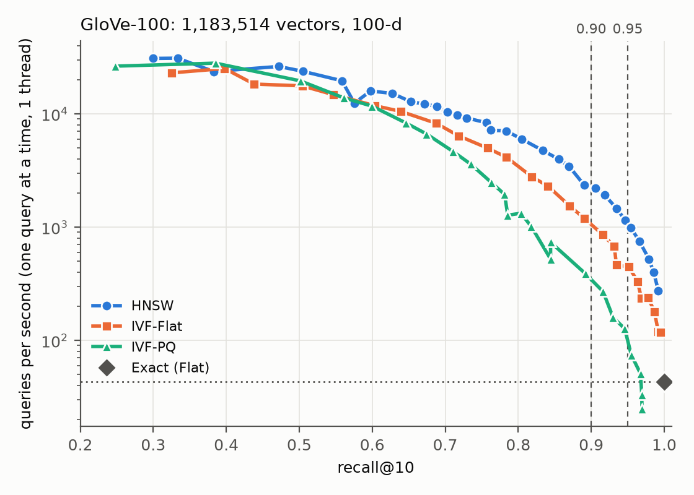
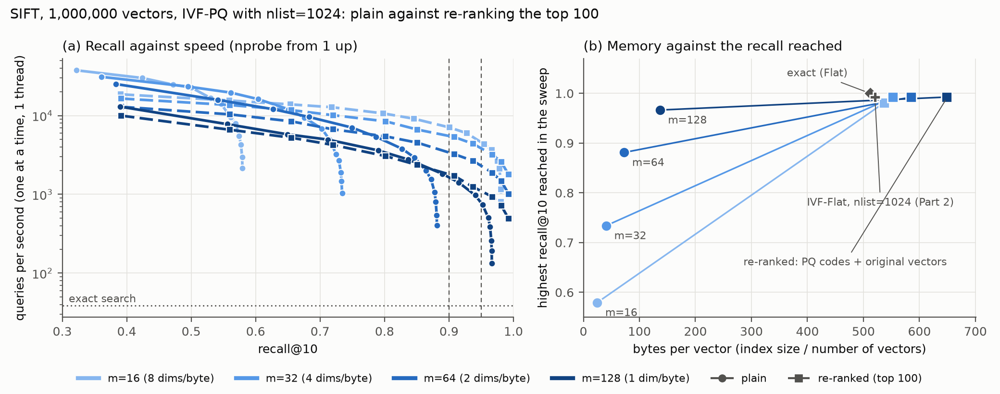
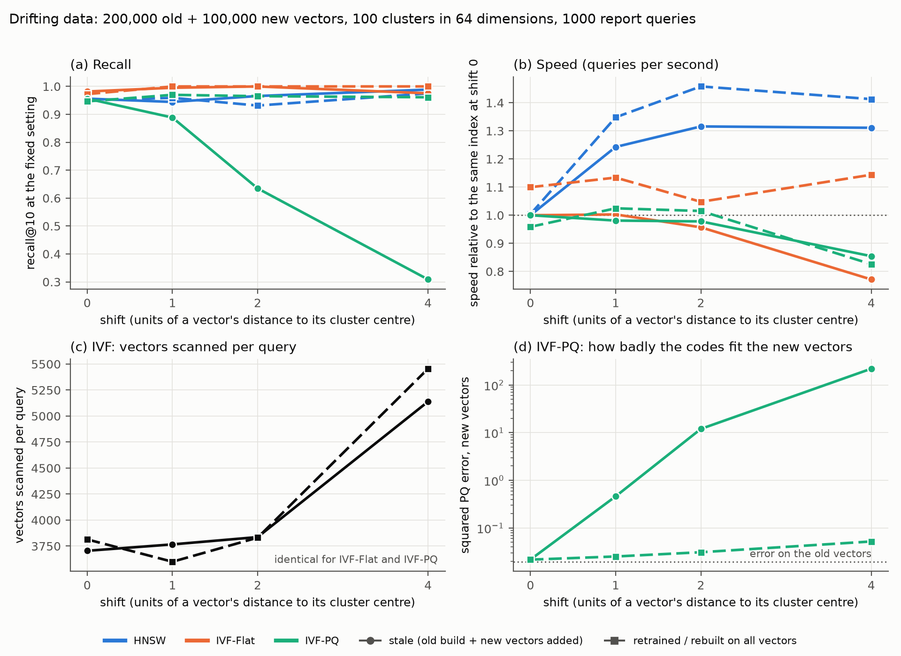

[github.com/Koilpillai/IRE-A3](https://github.com/Koilpillai/IRE-A3)

# Benchmarking approximate nearest neighbour search: HNSW, IVF-Flat and IVF-PQ

CS4.406 Assignment 3

## Setup

- **Machine:** Intel i7-13650HX laptop, 10 physical cores, 7.6 GiB RAM, WSL2 Linux. Python 3.11.7, FAISS 1.15.1, hnswlib 0.8.0, numpy 2.4.6. All runs were on this one machine.
- **Data:** SIFT (1M × 128) and GloVe-100 (1.18M × 100, normalised). Euclidean distance. The 10,000 queries are split in half: I pick settings on the first 5,000 and report on the last 5,000.
- **Recall@10:** my own function. An answer is correct if its true distance is no larger than the 10th true distance, so ties are not mistakes.
- **Speed:** queries per second (QPS), one query at a time, one thread, median of 3 timings (15 in Part 4).
- **Settings tried:** HNSW M = 8, 16, 32; IVF-Flat nlist = 256, 1024, 4096; IVF-PQ nlist 1024 (four m) and 4096.

Every run is a row in `results/results.csv`; `bash run_all.sh` regenerates all tables and figures.

## Part 1: exact search

FAISS `IndexFlatL2` matches the stored neighbours (recall 1.0). A few queries differ only by tied distances (65 on SIFT, 1 on GloVe).

| | one query at a time, 1 thread | one batch, 1 thread | one batch, 10 cores |
|---|---|---|---|
| SIFT | 25.8 ms (39 QPS) | 7.4 ms | 2.8 ms |
| GloVe-100 | 23.1 ms | 6.1 ms | 2.7 ms |

One query reads the whole dataset (512 MB for SIFT) from RAM, so memory speed is the limit. A batch reuses each block of vectors from cache for every query, so it is about 3.5× faster on one thread, and more cores add about 2.5×. This is inferred from the timings, not measured.

## Part 2: the three indexes

| dataset | index | QPS at 0.90 | QPS at 0.95 | setting at 0.95 | build (s) | bytes/vector |
|---|---|---|---|---|---|---|
| SIFT | Exact | 39 | 39 | – | 0.2 | 512 |
| SIFT | HNSW | 16,601 | 11,521 | M=32, ef=40 | 86 | 788 |
| SIFT | IVF-Flat | 3,031 | 2,148 | 4096 lists, nprobe 48 | 113 | 522 |
| SIFT | IVF-PQ | 1,339 | 564 | m=128, nprobe 32 | 73 | 137 |
| GloVe | Exact | 43 | 43 | – | 0.2 | 400 |
| GloVe | HNSW | 2,218 | 984 | M=32, ef=384 | 204 | 676 |
| GloVe | IVF-Flat | 861 | 445 | 4096 lists, nprobe 384 | 94 | 409 |
| GloVe | IVF-PQ | 270 | 74 | m=100, nprobe 256 | 64 | 108 |

*Table 1. Settings are picked on the tune queries; QPS is from the report queries. Build time and size are for the 0.95 setting.*

 

*Figure 1. Recall@10 against QPS, best result per index over all build settings (left SIFT, right GloVe).*

### Q1. At recall 0.95, which index is fastest? Does it change between datasets?

HNSW is fastest on both, but the lead changes: 5.4× faster than IVF-Flat on SIFT, only 2.2× on GloVe. IVF-PQ is last on both (on GloVe barely faster than exact search, 1.7×). GloVe is harder for every index (efSearch 384 against 40, nprobe 384 against 48).

HNSW walks a graph and compares the query with a small set of vectors. IVF must scan every vector in the lists it opens: about 12,000 on SIFT, but about 110,000 (9% of the data) on GloVe. IVF-PQ looks up distances in tables, which seems slower than IVF-Flat's plain arithmetic. I think GloVe is harder because its nearest neighbours are barely closer than other points. I did not measure either explanation.

### Q2. Build time and memory. What does PQ save and give up?

HNSW uses the most memory (vectors plus graph links) and is slow to build, since every insertion is a search. IVF-Flat adds almost no memory; its build is k-means. PQ stores m bytes per vector, 3.8× less than IVF-Flat, but gives up accuracy: when the error of an 8-bit code exceeds the gap between the 10th neighbour and the points behind it, the ranking is wrong however many lists are scanned. Scanning every list does not help (SIFT m=64: 0.872 against 0.881), so the codes are the limit. Only m = d reached 0.95 on both datasets. PQ is also slower.

## Part 3: compression on SIFT

**Hypothesis** (commit `c8c6adc`, before any Part 3 code or result): smaller m lowers plain recall; re-ranking helps most at small m, costs 10–30% of speed but is faster at equal recall, and saves no memory.

**Setup.** One IVF-PQ index (nlist 1024) per m = 16, 32, 64, 128. "Plain" ranks by PQ codes only; "re-ranked" re-ranks the top 100 with exact distances.

*Figure 2. (a) Recall against QPS, plain (circles) and re-ranked (squares). (b) Memory against the highest recall reached.*

| m | bytes/vector | highest recall | QPS at 0.90 | QPS at 0.95 |
|---|---|---|---|---|
| 16 | 25/537 | 0.580/0.981 | –/5,977 | –/3,676 |
| 32 | 41/553 | 0.734/0.992 | –/4,383 | –/3,201 |
| 64 | 73/585 | 0.881/0.993 | –/2,662 | –/1,881 |
| 128 | 137/649 | 0.967/0.993 | 1,415/1,242 | 739/930 |

*Table 2. Each cell is plain/re-ranked. – means the target was not reached. For reference, IVF-Flat with the same nlist: 521 bytes, recall 0.993, 1,367 QPS at 0.95.*

**Partly supported: three of five predictions held.**

- **Held:** plain recall falls with m (0.58 to 0.97), and scanning every list does not help. Plain speed roughly halves each time m doubles. Re-ranking saves no memory (537–649 bytes, more than IVF-Flat's 521).
- **Right direction, wrong size:** re-ranking helps most at small m, but m=16 reached 0.98, not 0.85–0.9. At the same nprobe it cost a median 12–30% of speed, and at equal recall it was faster only at 0.95 with m=128 (930 against 739 QPS).
- **Not predicted:** re-ranked m=16 is the fastest IVF at recall 0.95 (3,676 QPS, against 1,367 for IVF-Flat) at the same memory. I think it reads 16 bytes per candidate instead of 512; I did not test this.

## Part 4: drifting data

**Hypothesis** (commit `7eb8005`, before any Part 4 code or result): IVF-PQ degrades most (codebooks come from old data); IVF-Flat gets slower but keeps recall; HNSW is least affected; retraining fixes IVF; the control does not change.

**What I changed.** One thing: how far the later data is shifted. My seeded generator (`annbench/drift.py`) draws 100 Gaussian clusters in 64 dimensions. Each index is built on 200,000 old vectors; 100,000 new vectors are then added without retraining, and 2,000 queries are drawn like the new vectors. Both move by 0 (control), 1, 2 or 4 times a typical vector's distance to its cluster centre. Each index keeps one search setting that gave recall 0.95 on the control, and is measured **stale** (new vectors just added) and **retrained** (rebuilt on all 300,000).

*Figure 3. (a) Recall and (b) QPS at the fixed setting. (c) Vectors scanned per query. (d) PQ code error on the new vectors. Solid = stale, dashed = retrained.*

| index | measure | shift 0 | shift 1 | shift 2 | shift 4 |
|---|---|---|---|---|---|
| HNSW | recall, stale/retrained | 0.956/0.951 | 0.944/0.959 | 0.966/0.932 | 0.989/0.975 |
| | speed, stale ÷ retrained | 1.00 | 0.92 | 0.90 | 0.93 |
| IVF-Flat | recall, stale/retrained | 0.982/0.973 | 0.995/1.000 | 1.000/1.000 | 0.975/1.000 |
| | speed, stale ÷ retrained | 0.91 | 0.88 | 0.91 | 0.67 |
| IVF-PQ | recall, stale/retrained | 0.956/0.947 | 0.889/0.970 | 0.635/0.965 | 0.309/0.961 |
| | speed, stale ÷ retrained | 1.04 | 0.96 | 0.96 | 1.03 |

*Table 3. Recall@10 and speed. Shift 0 is the control.*

- **IVF-PQ collapses.** Recall falls from 0.96 to 0.31; retraining brings it back to 0.96. The cause is measured: the codebook was learned on old vectors, so shifted vectors fit their codes badly. The squared code error on new vectors is 0.022, 0.46, 12 and 220 at shifts 0, 1, 2 and 4 (at most 0.05 after retraining).
- **IVF-Flat** keeps its recall but is about 30% slower than the retrained index at shift 4. **HNSW** keeps its recall and is about 10% slower; I have no mechanism for that.
- **Not supported:** IVF-Flat was about 1.5× slower at shift 4, not "several times", and my fat-list explanation failed: stale and retrained indexes have similar largest lists and scan similar numbers of vectors, so I do not know why it is slower. Rebuilding HNSW took 9.5 s, not minutes; IVF-PQ was the most expensive to retrain (22.9 s).
- **Not tested:** gradual drift, deletions, rotations, new clusters, real data, other seeds.

## Q3. What did Parts 3 and 4 show? When could the headline numbers mislead?

Part 3: PQ's "137 bytes per vector" hides a recall under 0.97, and re-ranking restores recall but brings memory back to 537–649 bytes. So a memory number needs the recall it was reached at, and the other way round. Part 4: all numbers assume later data looks like the data the index was built on. When it does not, IVF-PQ can fail badly (0.31 recall) while its speed looks normal, so nothing warns you. Speed measured one query at a time on one thread also says nothing about batched use (exact search gains 3.5× from batching alone), and settings tuned on the reported queries flatter the result, which is why I report on a second half.

## Q4. 150,000 or 10 million vectors, 100 ms per query, 16 GB RAM

I assume SIFT-like vectors and recall 0.95, and scale my 1M timings (25.8 ms per query); I did not time other sizes.

**150,000 vectors: exact search, no ANN.** About 3.9 ms per query, recall 1.0, no build and nothing to tune.

**10 million vectors: ANN.** Exact search would take about 260 ms per query, over budget. I would use **HNSW with M=32 and efConstruction 200** (about 7.9 GB), starting from efSearch 40 on SIFT-like data (about 400 on GloVe-like). The cost is the build, at least 11–15 minutes. IVF-Flat (nlist about 16,384) is the simpler second choice; plain IVF-PQ is not worth it when 16 GB is enough for the raw vectors. **None of the 10M figures were measured:** my laptop has 7.6 GiB of RAM, so they extrapolate from 1M, and efSearch must be re-tuned at the real size.

## Q5. Two ways my benchmark could be misleading

**1. Speeds are noisy and come from one laptop.** *Tested, partly:* the same IVF-PQ settings were timed in Part 2 and again in Part 3. The median speed ratio is 0.98, but single points were up to 36% apart (IVF-PQ's 564 QPS in Table 1 against 739 in Part 3), and my two Part 4 runs differed by up to 28%. So speed gaps under about 30% should not be trusted; the ranking at recall 0.95 (HNSW first by 2.2× or more) is much bigger. *Not tested:* a second machine, and batched speed for the ANN indexes.

**2. One HNSW build is one sample.** hnswlib builds with several threads, so identical builds give slightly different graphs. *Tested in Part 4 only:* the same rebuilt index reached recall 0.916 in an earlier run and 0.959 in the final one (kept in `results/earlier_run_part4_3repeats.csv`). Part 2's HNSW numbers carry about the same uncertainty. *Not tested:* other build settings. Two explanations above (why GloVe is harder, why IVF-PQ is slower) are likely reasons, not findings.

